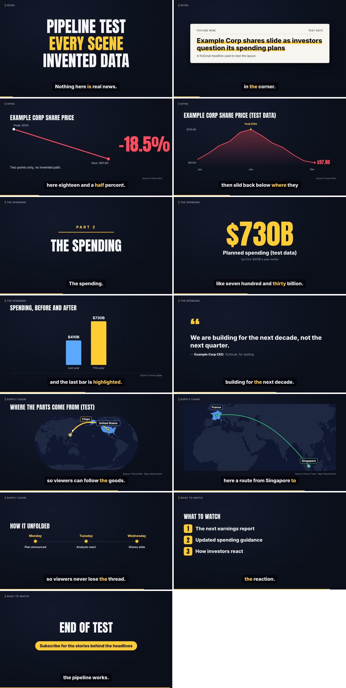
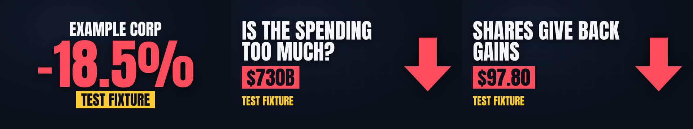

# Long-form video pipeline

Faceless long-form YouTube explainers on business, economy and tech, made with Claude Code + Remotion + ElevenLabs.





Claude researches a story and writes two files: a **fact ledger** (`research.json`) and a **script**
(`script.json`). The pipeline turns them into a finished video, thumbnail and description, and checks everything
along the way.

## What gets checked

| Stage | Checks |
|---|---|
| **check** (free) | Every scene matches the schema; text fits on screen; every number in narration cites a fact; facts marked "verified" have 2+ independent outlets; single-source / disputed facts are attributed; on-screen numbers match the cited claims; no placeholders; title ≤100 chars; no `<` `>`; hook first; hook ≤15 s; no visual held >30 s; research freshness; chapter count; length ≥8 min (mid-roll ads) |
| **voice** | Credit balance checked before spending; refuses to spend without `--spend`; retries on rate limits; caches every clip so unchanged scenes are free; word timings must fit the audio |
| **timeline** | Scenes contiguous with no gaps/overlaps; every scene has audio and captions; words in order and inside their scene; stale timeline detected if the script changed |
| **stills** | One frame per scene for a human (or Claude) to look at before the long render |
| **qc** | H.264 1920×1080 30 fps yuv420p BT.709; AAC audio; duration matches; loudness −14 LUFS ±2 and true peak ≤ −1 dBTP; dead air >2.5 s; black frames; static picture >5 s; YouTube chapter rules; thumbnail 1280×720 ≤2 MB; description ≤5000 chars with sources; mock builds can't pass |

## Commands

```bash
npm install
npm run ep -- new my-episode            # scaffold episodes/my-episode/
npm run ep -- check my-episode          # lint + cost estimate (free)
npm run ep -- build my-episode --mock   # whole pipeline with silent placeholder voice (free)
npm run ep -- build my-episode --spend  # real voice-over, render, QC
npm run studio                          # Remotion Studio to preview scenes
npm run verify                          # typecheck + tests + mock build of the test fixture
```

Output lands in `out/<slug>/`: `video.mp4`, `thumbnail.png` (+ `thumbnail-2/3.png` variants), `description.txt`, `upload.json`, `qc-report.json`, `stills/`.

## Requirements

Node 22+, ffmpeg/ffprobe on PATH, an ElevenLabs key in `ELEVENLABS_API_KEY` (not needed in the cloud session,
where it is injected). Remotion downloads its own headless Chrome if none is configured.

Remotion's official agent skills for Claude Code are installed in `.claude/skills/` (pinned in `skills-lock.json`).

## Not built yet

- YouTube upload (needs a Google Cloud project + OAuth consent; `upload.json` already holds the metadata).
- Background music / sound effects (needs a licensed library).
- Story discovery (trend scanning); for now Claude researches on request.
